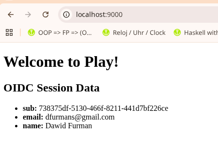
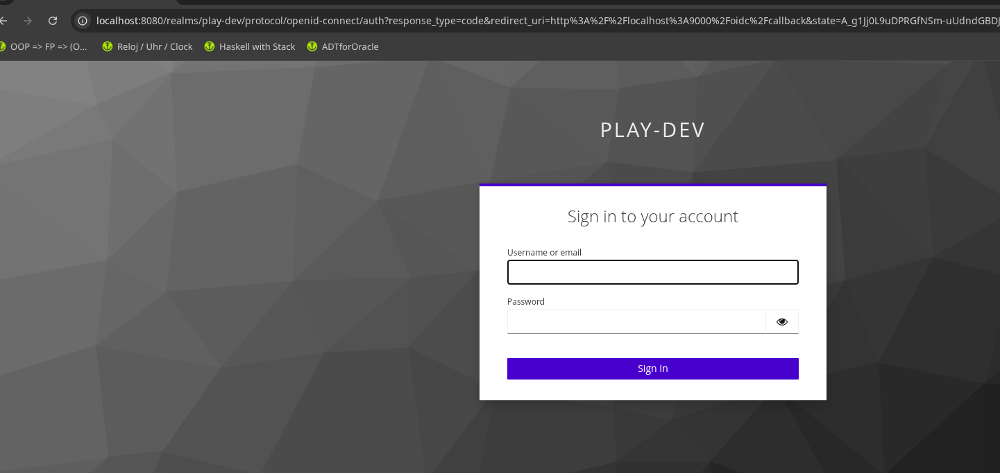
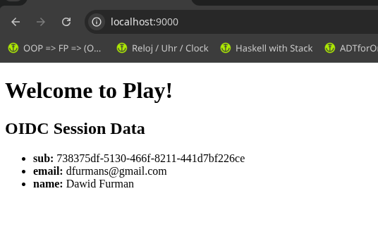

Here is your updated and comprehensive **`README.md`** for `examples/quickstart/README.md`. It now seamlessly integrates the Keycloak setup steps, Docker Compose instructions, and the corresponding `application.conf` configuration.

```markdown
# Play Auth SSO - Quickstart Example

This is a sample Play Framework application demonstrating how to integrate and use the [play-auth-sso](https://github.com/dfurmans/play-auth-sso) OIDC plugin with a local Keycloak identity provider.

---

## 0. Local OIDC Provider Setup (Keycloak)

### Step 1: Start Keycloak with Docker Compose

Navigate to the `examples/quickstart` directory and start Keycloak in dev mode:

```bash
docker compose up -d

```

> **Manual Docker alternative:**
> ```bash
> docker run -p 8080:8080 \
>   -e KEYCLOAK_ADMIN=admin \
>   -e KEYCLOAK_ADMIN_PASSWORD=admin \
>   quay.io/keycloak/keycloak:23.0.7 \
>   start-dev
> 
> ```
>
>

---

### Step 1: Configure Keycloak Realm & Client

1. Navigate to `http://localhost:8080/admin` in your browser and log in with `admin` / `admin`.
2. **Create Realm:**
* In the top-left dropdown (currently showing `master`), click **Create Realm**.
* Name the realm `play-dev` and click **Create**.


3. **Create OIDC Client:**
* Go to **Clients** → **Create client**.
* Set **Client ID** to `play-app`. Leave other defaults and click **Next**.
* Ensure **Standard flow** (*Authorization Code flow*) is checked and click **Next**.
* Under **Valid redirect URIs**, enter: `http://localhost:9000/oidc/callback`
* Under **Valid post logout redirect URIs**, enter: `http://localhost:9000/`
* Click **Save**.


4. **Copy Client Secret:**
* Go to the **Credentials** tab of your newly created `play-app` client and copy the **Client Secret**.


---

### Step 2: Create a Test User

1. In the `play-dev` realm, go to **Users** → **Add user**.
2. Enter a username (e.g., `dev-user`) and click **Create**.
3. Go to the **Credentials** tab for this user and click **Set password**.
4. Enter a password (e.g., `password`), turn **OFF** *Temporary*, and save.

---

## 2. Play Application Configuration (`conf/application.conf`)

Wire your Play application to your local Keycloak instance by adding the following block to `examples/quickstart/conf/application.conf`:

```hocon
nimbus.oidc {
  # Keycloak issuer URL format: {server-root}/realms/{realm-name}
  issuer        = "http://localhost:8080/realms/play-dev"
  client_id     = "play-app"
  
  # Paste the secret copied from Keycloak (Clients -> Credentials)
  client_secret = "your-copied-client-secret"
  
  callback_url    = "http://localhost:9000/oidc/callback"
  
  post_login_url  = "/"
  post_logout_url = "/"
}

```

---

## 3. Running the Example Application

Since this example is part of the monorepo, it references the local core plugin source directly:

1. Navigate to the **root directory** of the project:
```bash
cd ../../

```


2. Start the SBT console:
```bash
sbt

```


3. Switch to the example project and start the server:
```text
> project example
[quickstart-app] $ run

```


4. Open your browser and navigate to `http://localhost:9000`.

---

## 4. Code Walkthrough

### Controller (`HomeController.scala`)

The controller extracts all active session claims populated by the plugin upon authentication:

```scala
package controllers

import javax.inject._
import play.api._
import play.api.mvc._

@Singleton
class HomeController @Inject()(val controllerComponents: ControllerComponents) extends BaseController {

  def index() = Action { implicit request: Request[AnyContent] =>
    val sessionData = request.session.data
    
    // Prints session claims to the sbt console for debugging
    println(s"Session Data: $sessionData")

    Ok(views.html.index(sessionData))
  }
}

```

### View (`index.scala.html`)

The view iterates over the session data map to render user claims (like `sub`, `email`, and `name`):

```html
@(sessionData: Map[String, String])

@main("Welcome to Play") {
  <h1>Welcome to Play!</h1>

  <h2>OIDC Session Data</h2>
  @if(sessionData.isEmpty) {
    <p>No session data found. User is not authenticated.</p>
  } else {
    <ul>
    @for((key, value) <- sessionData) {
      <li><strong>@key:</strong> @value</li>
    }
    </ul>
  }
}

```

## You should see 



## Full user story / user stroy flow

### login http://localhost:9000/oidc/login

 

### redirect to app with the IdP data stored into the APP Session object

